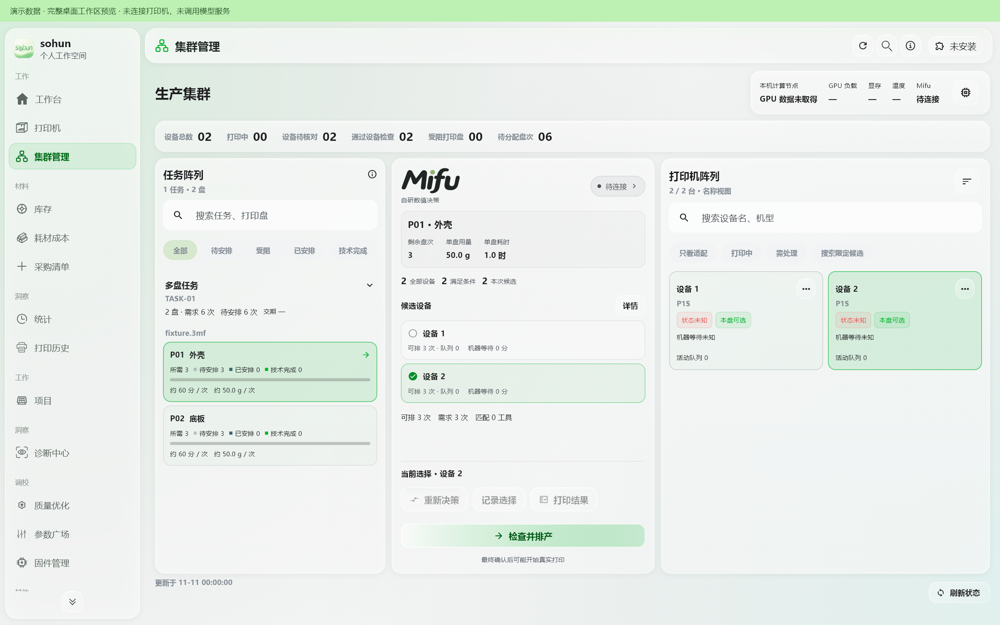

# Mifu · 自研数值决策

Mifu 是由 Sohun 项目作者自主设计与训练的数值决策模型及配套集群管理系统。它面向3D打印工作流，将任务分盘、设备条件、选择记录和结果复核组织在同一个工作台中。

当前自研模型 **Mifu Core** 专注于一个明确问题：在候选设备已经通过条件检查、耗时信息完整时，为当前打印盘比较预计完成时间，并在完成时间相同时比较准备时间。模型结构、数值特征、训练过程、权重与评估记录均由本项目维护。

## 1.1.0+9 交付范围

| 部分 | 提供的内容 | 当前状态 |
| --- | --- | --- |
| Windows 集群工作区 | 多盘任务、设备名称阵列、Mifu 中枢、人工检查与排产入口 | 随客户端交付；实际执行仍需通过设备检查并由用户确认 |
| 本机 HTTP 与采集源码 | 条件预检、选择快照、打印结果、独立质检、更正事件及人工复核导出 | 需要单独启动；没有合格权重时为 `unconfigured`，可先采集记录 |
| Mifu Core 原生数值模型 | 独立离线导出、推理与完整性检查入口 | 已完成本地离线训练与验证；模型包不随客户端安装器或 APK 自动打包，尚无生产资格 |

Android 继续提供耗材读写和库存同步，不包含桌面集群全套布局。客户端更新、服务启动和模型质量验收是不同环节；检测到 GPU 只说明取得主机信息，不表示模型已加载或正在推理。

图为当前 Flutter 组件与示例数据，未连接打印机、未调用模型服务。任务支持多盘及每盘多次打印；设备以名称排列。操作窗口使用居中弹窗。

## 自研的内容

- 数值比较网络与训练权重：以已知整数耗时的差值学习候选偏好，不调用聊天模型，不依赖通用基础模型生成答案。
- 输入与结果契约：明确候选、目标、数据来源、时间有效性及未知值处理，避免将缺失信息当作零。
- 集群交互与数据闭环：任务阵列、打印盘、设备名称阵列、条件检查、人工选择、结果采集和复核流程。
- 可复现评估：固定开发回归、新测试、边界压力、候选换序与文件完整性核验。

这里的“自研”指上述模型和应用层设计，不表示Python、PyTorch、Flutter等基础工具也由本项目从零开发，更不是通用大语言模型的从零预训练。

## 独立运行

Mifu Core 提供独立的离线导出与推理入口。当前网络为自主随机初始化训练的 **640 参数共享两两比较 MLP**，使用 **CPU FP64**；运行环境使用 Python 和 PyTorch。原生数值推理不加载 Laya、Transformer、tokenizer 或第三方基础权重。输出是候选偏好分及选择结果，不是打印成功概率，也不会直接启动设备。

原生模型包和现有桌面 HTTP 服务是不同交付层：没有把离线模型未经实机验收就接成线上 `ready`，也没有授予自动派单权限。独立包已实际导出，并在禁止加载基础模型运行组件的独立进程中复验 1920 例，选择与分数均和导出前完全一致。这是旧压力题的包装回归，不增加独立测试样本数。源码及命令见[本地模型服务说明](../电脑软件/mifu_service/README.md)；公开源码不附带本地实验、权重和数据缓存。

## 当前验证范围

2026-11-13 的合成单盘耗时排序测试中，Mifu 数值分支在 3584 道非全平局新题、其中 3394 道未见数值投影子集，以及另一组 1904 道非全平局宽域压力题上均全部正确。三者有不同范围，不能相加当作独立样本总数，也不代表真实打印成功率或全部业务 100%。原始逐题报告、权重和训练记录保留在项目本地，不作为公开客户端附件。

维修风险、实际耗时预测、材料/喷嘴/AMS/盘面适配与多盘全局排程需要各自的证据、实现和实机验收，不能用单盘排序成绩替代。现有功能、开发计划和未验收能力分开记录，不将研究目标标成已实现功能。

## 真实记录如何进入后续训练

先保存当时的打印盘、合格候选、设备和耗材证据，再记录人工选择。每次实际打印建立独立批次，执行结果与人工质检分开；修改内容追加更正事件，保留原记录。未知时间、余量、几何和维护证据保持未知，不补成零或默认合格。

接受建议、机器完成和一次质检通过都不会自动变成“最优设备”的标签。人工独立复核后，才能按任务和等价输入分组导出训练、验证、校准与留出数据；仍需完成时间外和真实业务验收。当前采集服务面向同一操作系统用户的本机使用，不是多租户认证服务。

模型的运行框架与历史兼容研究来源统一记录于[组件与研发来源](mifu-components.md)，不占用集群主界面的操作空间。
