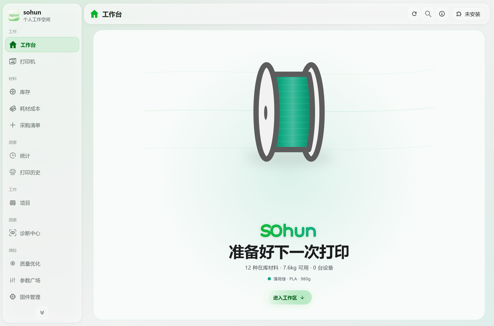
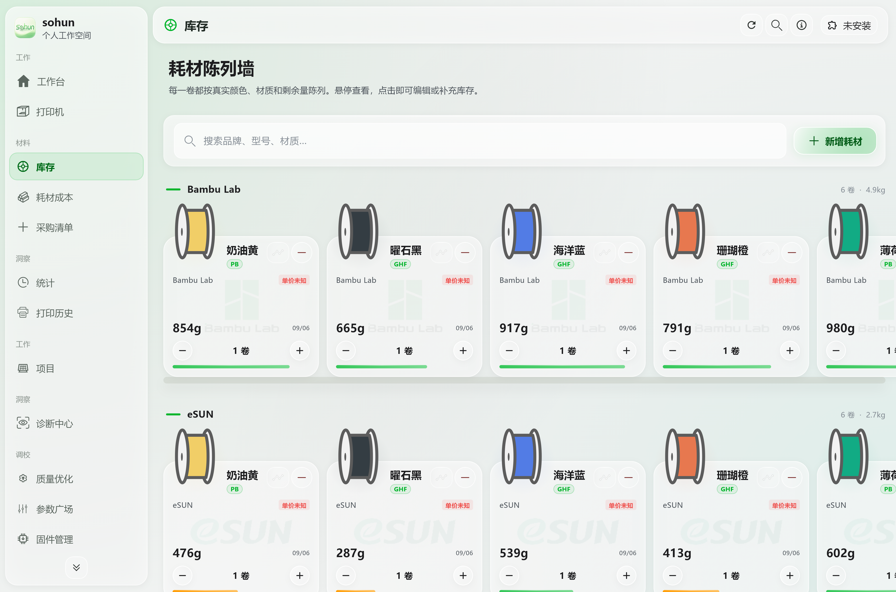

# Sohun 1.0.2+8 · Windows 桌面核心版

本次完成 Windows 10/11 x64 的公开核心版交付，提供安装器与便携包，正式标签为 `v1.0.2+8`。**沿用现有桌面界面，不重新设计布局或导航。** 手机、桌面共用的品牌识别更新随本次桌面构建交付，Android 1.0.2+7 的 APK 与手机改版说明保留在原 Release，不重新打包或替换。

[下载 Windows 安装器](https://github.com/dkdjndbfj-wq/sohun/releases/download/v1.0.2%2B8/sohun-setup-1.0.2-8-windows-x64.exe) · [下载 Windows 便携包](https://github.com/dkdjndbfj-wq/sohun/releases/download/v1.0.2%2B8/sohun-1.0.2-8-windows-x64.zip) · [SHA-256 校验清单](https://github.com/dkdjndbfj-wq/sohun/releases/download/v1.0.2%2B8/SHA256SUMS.txt) · [构建与签名记录](https://github.com/dkdjndbfj-wq/sohun/releases/download/v1.0.2%2B8/release-manifest.json) · [Android 1.0.2+7](https://github.com/dkdjndbfj-wq/sohun/releases/tag/v1.0.2%2B7)

## 现有桌面界面预览

下方沿用项目已有的真实 Flutter 界面组件预览，内容为示例账号与库存，展示现有工作台和库存布局，**不是本次新设计的桌面截图**。手机读卡弹窗及 SVG 导航预览仍归属于 Android 1.0.2+7，不代表本轮 Windows 界面变动。

### 个人工作台

### 个人耗材库存

预览用于说明界面，不作为打印机、标签、摄像头或公网服务已完成实机验收的证明。

## 本次桌面交付范围

- 重新构建 Windows Release 安装器和完整便携包，使用独立的 1.0.2+8 标签、附件清单与 SHA-256 校验文件，不沿用旧安装包冒充新版本。
- 桌面与手机共用品牌识别规则：`bambu`、`Bambu Lab`、`BBL` 与 `拓竹` 规范为“拓竹”，`eSUN` 与 `易生` 规范为“eSUN”。材料类型使用 PLA、PETG、ABS 等纯类型名称，不混入品牌前缀。
- 沿用个人库存、实物卷追踪和账号同步流程；每一实物卷固定 **1000g**，余量严格大于 **30g** 才能继续使用或重新装入。30g 及以下的历史余额保留核对，不自动清零，换卷不覆盖旧余料余额。
- CUID/FUID 负责耗材资料、写卡登记、入库与余量追踪；NTAG213 仅用于独立设备工作台，不进入耗材库存。

这是**公开核心版，不是完整厂商集成版本**。成品排除未完成再分发审查的 Bambu 私有网络组件、厂商资源、预置校准模型、离线故障资料，以及 `media_kit_libs_windows_video`、FFmpeg/libmpv 等 Windows 视频运行时，不保证这些被排除组件对应的厂商连接、资源或视频功能。品牌名称规范化不等同于附带厂商私有图片与资源包。

本次 Windows 安装器与便携版均**未做 Authenticode 签名**，可能显示未知发布者或 SmartScreen 提示；GitHub 的正式 Release 标记不是微软发布者认证。完整边界见 [公开发布清单](https://github.com/dkdjndbfj-wq/sohun/blob/v1.0.2%2B8/PUBLIC_RELEASE_MANIFEST.md)。

## 安装与升级

升级前先完成库存同步或备份，并退出正在运行的 sohun。**通常不需要先卸载旧版**；不要为了升级删除原有用户数据。

### 使用安装器

1. 下载 `sohun-setup-1.0.2-8-windows-x64.exe` 与本 Release 的 `SHA256SUMS.txt`。
2. 使用 PowerShell `Get-FileHash -Algorithm SHA256 .\sohun-setup-1.0.2-8-windows-x64.exe`，将结果与校验清单逐项核对。
3. 确认来源及哈希后运行安装器。遇到安全提示时先核对来源，不要全局关闭安全防护。
4. 启动后核对版本、所用账号、库存和余料记录；发现异常时保留原数据并反馈。

### 使用便携包

1. 下载 `sohun-1.0.2-8-windows-x64.zip`，核对清单中的 SHA-256。
2. **完整解压**到新的可写目录，再运行其中的 `sohun.exe`。
3. 不要在压缩包里直接运行 EXE，也不要仅将新版 EXE 覆盖进旧目录；DLL 和资源必须使用同一版本。
4. 核对账号与数据后再处理旧目录；保留升级前的同步记录或备份。

附件 `release-manifest.json` 记录构建来源、版本、文件大小、哈希及签名状态；`SHA256SUMS.txt` 用于下载后校验。实际自动化验收范围以构建记录为准，本说明不声称全仓 CI 已全部通过。

## 硬件与反馈

本次发布不代表真实 NFC、CUID/FUID 卡片、AMS 或所有打印机固件已完成实测。兼容写卡需要用户持有的完整有效源模板，软件不生成厂商签名，也不保证任意自填品牌、类型、颜色能成为 AMS 认证资料。

遇到问题请在 [Issues](https://github.com/dkdjndbfj-wq/sohun/issues) 提供版本、Windows 版本、安装器或便携版、设备型号、错误提示与复现步骤。请遮挡个人信息，不要上传账号凭据、标签密钥或完整源模板。
