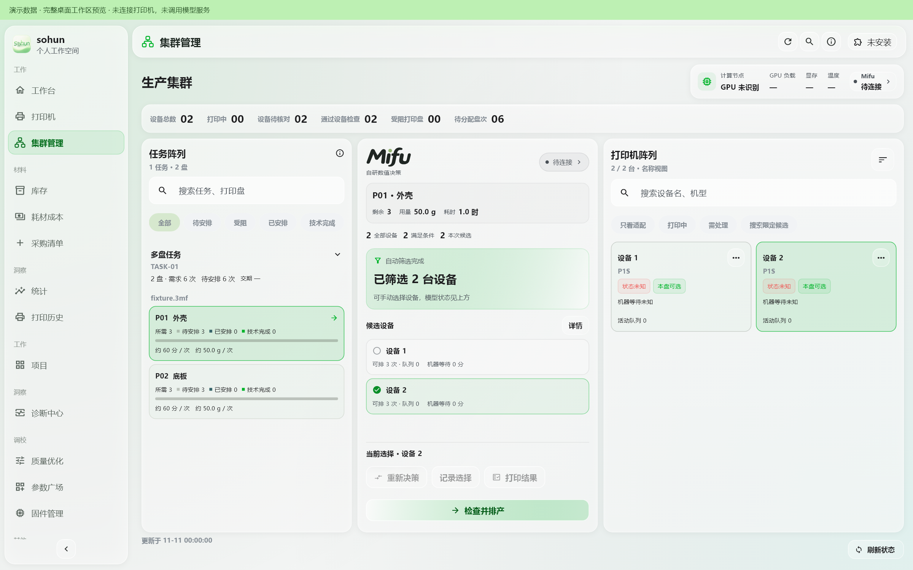
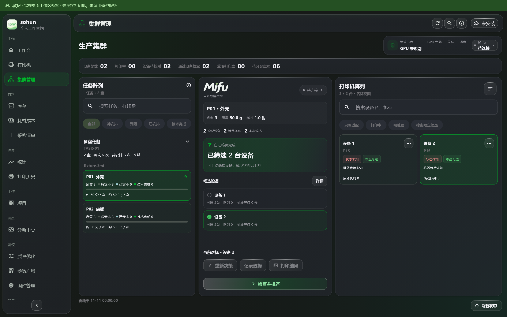

# Sohun 1.1.0+10 · 集群工作区与 Mifu

本版同时提供 Windows 和 Android 客户端。桌面把多盘任务、设备阵列和 Mifu 中枢放到同一工作区，补齐从选择设备到打印结果、人工质检与后续复核的流程。手机延续简洁读卡、居中弹窗与库存同步。

## 桌面集群，一眼看到任务与设备

左侧任务阵列支持一个任务包含多盘、每盘多次打印，分别显示需求、待安排、已安排和技术完成。右侧使用设备名称与状态卡片，便于增加设备后继续查找与筛选。中间保留当前盘、候选设备和操作入口；顶部展示真实可取得的 GPU 状态，未知值保持未知。

两图均由本版 Flutter 界面组件重新渲染，使用示例任务和设备，未连接打印机、未调用模型服务。截图展示实际布局，不代表已完成真机打印、推理效果或完整安装包验收。

## 从一次选择到可复核记录

1. 从已有任务中选择具体打印盘，检查机型、喷嘴、供料、耗材和队列条件。盘面尺寸、刀路与未知证据保留各自状态，不将面积相近视为必然适配。
2. 连接支持新版输入的本机服务后，可在居中窗口填写逐台取件、换板、换料的预计准备时间；空白与明确的 0 分开处理。检查与比较使用同一份输入，变化或过期后需要重新确认。
3. 人工记录设备选择，为每次实际打印建立独立批次。执行状态、实际耗时、用料和失败线索分别采集；机器完成不等于成品质检合格。
4. 独立记录人工质检，纠错时保留原记录和更正原因。接受模型建议不会直接变成训练标签，后续需要独立人工复核与分组导出。

“检查并排产”仍遵循设备检查和最终人工确认；模型建议不会自行启动打印。集群界面不新增任务创建入口，任务继续从原有业务入口添加。

## Mifu 的交付范围

Mifu Core 是本项目自主设计并从随机初始化训练的 640 参数数值比较网络，当前以 CPU FP64 独立运行。在候选已满足条件且耗时信息完整时，它比较当前单盘的预计完成时间，并在完成时间相同时比较准备时间。原生推理不依赖 Laya、Transformer、分词器或第三方基础权重。

本版公开本机服务、采集、复核及原生离线入口源码。**原生模型包是独立的本地离线产物，不随 Windows 安装器或 Android APK 自动打包，也尚未取得生产验收资格。** 没有已验收权重时，HTTP 服务保持“待配置”；检测到显卡不等于模型正在推理。

合成单盘排序与独立包装回归已完成，具体范围见 [Mifu 产品与验证说明](https://github.com/dkdjndbfj-wq/sohun/blob/v1.1.0%2B10/docs/mifu.md)。这些成绩不是实际打印成功率，不能证明维修风险、耗时预测、全部 AMS/喷嘴/盘面适配或多盘全局最优。原始实验与模型权重保留本地，当前模型不授权自动派单。[组件与研发来源](https://github.com/dkdjndbfj-wq/sohun/blob/v1.1.0%2B10/docs/mifu-components.md) 保留原有第三方来源和许可记录。

## 手机与库存

Android 继续使用一个“读取 CUID / FUID”主入口：读到资料后核对品牌、纯材料类型、颜色和入库数量；确认空白新卡后进入独立写卡窗口。操作使用居中弹窗，品牌别名和库存规则与桌面共用。手机不包含整套桌面集群界面。

每一实物卷固定 1000g，当前余量独立保存；严格大于 30g 才能继续使用或重新装入。CUID/FUID 负责耗材资料与库存，NTAG213 只用于设备工作台。写入 AMS 兼容内容仍需用户持有的有效完整源模板，不把任意自填资料宣传为厂商认证标签。[手机读卡指南](https://github.com/dkdjndbfj-wq/sohun/blob/v1.1.0%2B10/docs/mobile-reader-guide.md) 中的既有手机预览使用示例数据，具体 NFC/AMS 兼容性需实机确认。

## 下载与升级

供料目录已复核上游新增的 H3C：本版仍将其视为未支持机型，拒绝按相近型号发送打印任务。社区邮件组件和历史网页项目已更新存在安全公告的依赖；该源码更新不表示官网服务器已完成部署。

| 附件 | 用途 |
| --- | --- |
| [sohun-setup-1.1.0-10-windows-x64.exe](https://github.com/dkdjndbfj-wq/sohun/releases/download/v1.1.0%2B10/sohun-setup-1.1.0-10-windows-x64.exe) | Windows 10/11 x64 安装器 |
| [sohun-1.1.0-10-windows-x64.zip](https://github.com/dkdjndbfj-wq/sohun/releases/download/v1.1.0%2B10/sohun-1.1.0-10-windows-x64.zip) | Windows 完整便携包 |
| [sohun-1.1.0-10-android.apk](https://github.com/dkdjndbfj-wq/sohun/releases/download/v1.1.0%2B10/sohun-1.1.0-10-android.apk) | Android 正式签名 APK |
| [SHA256SUMS.txt](https://github.com/dkdjndbfj-wq/sohun/releases/download/v1.1.0%2B10/SHA256SUMS.txt) | 附件完整性校验 |
| [release-manifest.json](https://github.com/dkdjndbfj-wq/sohun/releases/download/v1.1.0%2B10/release-manifest.json) | 实际构建、附件和签名状态 |

升级前先同步或备份库存并退出旧版。Windows 安装器与便携包均未做 Authenticode 签名；便携包请完整解压到新目录，避免只替换 EXE 混用文件。Android 使用长期发行密钥，包名为 `top.sohun.consumable_tracker`；遇到旧调试包签名冲突时先备份数据。

本版为公开核心版，不包含尚未审查的厂商资源、私有网络组件和 Windows 视频运行时；范围见 [公开发布边界](https://github.com/dkdjndbfj-wq/sohun/blob/v1.1.0%2B10/PUBLIC_RELEASE_MANIFEST.md)。图文介绍随源码提供，宣传剪辑素材压缩包不上传 GitHub Release。正式发布状态、哈希和签名以对应 Release 的实际附件为准。
